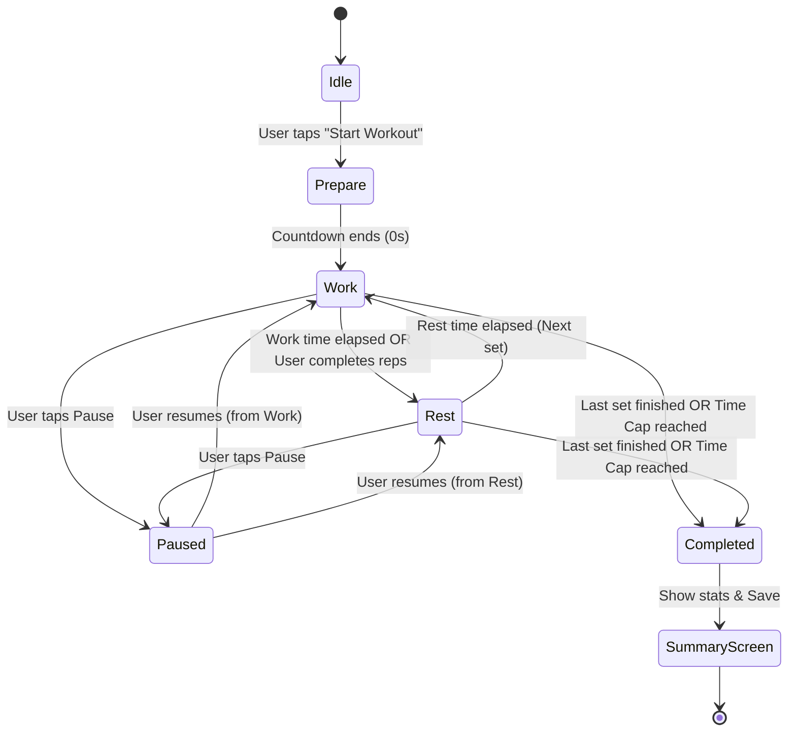

# KIẾN TRÚC KỸ THUẬT (TECHNICAL ARCHITECTURE)
## DỰ ÁN: HAMINO WORKOUT

---

| Thuộc Tính | Chi Tiết |
| :--- | :--- |
| **Dự án** | Hamino Workout |
| **Công nghệ nền tảng** | Flutter 3.x (Dart 3.x) |
| **Mô hình kiến trúc** | Feature-First Clean Architecture (Domain - Data - Presentation) |
| **Quản lý trạng thái** | BLoC Pattern (`flutter_bloc`) |
| **Lưu trữ dữ liệu cục bộ** | SQLite via `sqflite` / `drift` (hoặc `hive_flutter` cho cấu hình nhẹ) |
| **Hệ thống âm thanh** | `flutter_tts` (Text-to-Speech) + `audioplayers` (SFX Beeps) + `audio_session` |
| **Độ chính xác Timer** | Timestamp-delta Precision Engine (chống trôi thời gian do CPU throttle) |

---

## 1. TỔNG QUAN KIẾN TRÚC HỆ THỐNG (SYSTEM OVERVIEW)

```
┌─────────────────────────────────────────────────────────────────┐
│                       PRESENTATION LAYER                        │
│   Widgets / Screens (Workout Player, Builder, History, Settings) │
│                BLoC / Cubit (State Management)                  │
└────────────────────────────────┬────────────────────────────────┘
                                 │
┌────────────────────────────────▼────────────────────────────────┐
│                          DOMAIN LAYER                           │
│   Use Cases (StartWorkout, TickTimer, SpeakCue, SaveSession)   │
│   Entities (Workout, Exercise, TimerState, SessionRecord)       │
│   Repository Interfaces                                         │
└────────────────────────────────┬────────────────────────────────┘
                                 │
┌────────────────────────────────▼────────────────────────────────┐
│                           DATA LAYER                            │
│   Repository Implementations                                    │
│   Data Sources:                                                 │
│     - Local DB (SQLite/Sqflite: Workouts, Exercises, History)   │
│     - Local Storage (SharedPreferences: App Settings)           │
│   External Services:                                            │
│     - AudioService (flutter_tts & audioplayers)                 │
│     - WakelockService (wakelock_plus)                           │
│     - NotificationService (flutter_local_notifications)         │
└─────────────────────────────────────────────────────────────────┘
```

---

## 2. THIẾT KẾ CỐT LÕI: HIGH-PRECISION WORKOUT TIMER ENGINE

### 2.1. Vấn đề "Trôi thời gian" (Timer Drift Problem)
Trong các ứng dụng thể thao, việc sử dụng `Timer.periodic(Duration(seconds: 1))` thông thường sẽ gặp lỗi nghiêm trọng:
- Khi hệ điều hành Android/iOS điều tiết CPU hoặc chuyển sang trạng thái ngủ (Doze mode), các callback của `Timer.periodic` bị delay, dẫn đến sau 20 phút tập, đồng hồ có thể lệch từ 5 đến 30 giây.
- Âm thanh đếm ngược 3-2-1 có thể bị giật hoặc đọc chậm so với thời gian thực.

### 2.2. Giải pháp: Timestamp-Delta Ticker Architecture
Bộ đếm giờ của **Hamino Workout** được thiết kế dựa trên mốc thời gian tuyệt đối (`DateTime.now()`):

```dart
class PrecisionTicker {
  Stream<Duration> tick({required Duration interval}) {
    return Stream.periodic(interval, (_) => DateTime.now())
        .map((timestamp) => timestamp);
  }
}
```

- **Cơ chế tính toán:**
  - Khi bắt đầu một hiệp (Work hoặc Rest), ghi lại mốc `startedAt = DateTime.now()`.
  - Mọi mốc thời gian còn lại được tính bằng:
    $$\text{remainingSeconds} = \text{targetSeconds} - \left(\frac{\text{DateTime.now()} - \text{startedAt}}{1000}\right) + \text{pausedDuration}$$
  - Tick interval chạy ở tần số **100ms** để cập nhật animation mượt mà, nhưng số giây logic hiển thị và kích hoạt âm thanh dựa trên giá trị làm tròn nguyên của `remainingSeconds`.

### 2.3. Máy trạng thái tập luyện (Workout Finite State Machine - FSM)



- **Các trạng thái (TimerState):**
  1. `WorkoutInitial`: Chưa bắt đầu, màn hình xem trước giáo án.
  2. `WorkoutPrepare`: Đếm ngược chuẩn bị vào tập (mặc định 5s hoặc 10s).
  3. `WorkoutWork`: Đang trong hiệp tập (đếm ngược thời gian tập hoặc đếm tiến số rep/hiệp).
  4. `WorkoutRest`: Đang trong thời gian nghỉ giữa các hiệp hoặc giữa các bài.
  5. `WorkoutPaused`: Tạm dừng toàn bộ đồng hồ và giữ nguyên trạng thái.
  6. `WorkoutCompleted`: Hoàn thành toàn bộ số hiệp hoặc hết giới hạn thời gian (Time Cap).

---

## 3. HỆ THỐNG ÂM THANH & TRỢ LÝ GIỌNG NÓI (AUDIO & VOICE CUE ENGINE)

Hệ thống âm thanh được tách riêng thành một Service độc lập (`AudioCueManager`), lắng nghe các sự kiện từ `WorkoutBloc`:

```
 WorkoutBloc State Change
          │
          ▼
   AudioCueManager ─── Check Settings (Mute, Volume, Language)
          │
     ┌────┴─────────────────────────────┐
     ▼                                  ▼
[AudioPlayers]                    [FlutterTTS]
- Countdown Beep (3, 2, 1)        - "Bắt đầu hiệp 1: Kéo xà 10 cái"
- Whistle / Bell (Start/End)      - "Nghỉ 60 giây"
- Halfway Beep                    - "Còn 10 giây nghỉ"
```

### 3.1. Các sự kiện kích hoạt âm thanh (Audio Triggers)
| Sự Kiện | Âm Thanh Hiệu Ứng (SFX) | Giọng Đọc Trợ Lý (TTS) |
| :--- | :--- | :--- |
| **Bắt đầu đếm chuẩn bị** | Short Beep mỗi giây | "Chuẩn bị: [Tên bài tập]" |
| **Đếm ngược 3, 2, 1** | Beep cao độ (Pitch high) | "3, 2, 1" (tùy chọn) |
| **Bắt đầu hiệp (Work Start)** | Whistle / Boxing Bell | "Hiệp [X], Bắt đầu!" hoặc "Go!" |
| **Hết hiệp, vào nghỉ (Rest Start)** | Soft Chime | "Hết hiệp! Nghỉ [Y] giây." |
| **Nhắc nhở sắp hết giờ nghỉ (10s trước)** | Subtle Tick | "Còn 10 giây, chuẩn bị [Tên bài]" |
| **Đạt mốc thời gian (10p, 20p)** | Double Beep | "Đã tập được [Z] phút" |
| **Hoàn thành buổi tập** | Victory Fanfare | "Chúc mừng bạn đã hoàn thành buổi tập!" |

### 3.2. Quản lý Focus âm thanh (Audio Session & Ducking)
Sử dụng gói `audio_session` để cấu hình:
- **Audio Ducking:** Khi Hamino Workout phát giọng nói hoặc tiếng beep, nhạc nền từ Spotify/Youtube Music trên máy người dùng sẽ tự động giảm âm lượng tạm thời (duck) xuống 20-30%, sau khi đọc xong sẽ phục hồi âm lượng cũ.
- Chế độ âm thanh: `AudioSessionCategory.ambient` hoặc `playback` để không bị ngắt nhạc của người dùng.

---

## 4. MÔ HÌNH DỮ LIỆU CỐT LÕI (DATA SCHEMA & MODELS)

### 4.1. Entity: WorkoutTemplate (Mẫu bài tập)
```dart
enum WorkoutCategory {
  emom,       // Every Minute on the Minute
  endurance,  // Circuit, high-volume, rounds for time
  skill,      // Isometric holds, long neural recovery
  cardio,     // Tabata, HIIT, bodyweight conditioning
  custom      // Free custom combinations
}

class WorkoutTemplate {
  final String id;
  final String title;
  final String description;
  final WorkoutCategory category;
  final int prepareTimeSeconds;       // Mặc định: 10s
  final int? timeCapSeconds;          // Giới hạn tổng thời gian (ví dụ: 1200s = 20 phút)
  final int targetRounds;             // Số vòng/hiệp dự kiến (ví dụ: 5 rounds)
  final List<WorkoutExercise> exercises;
  final DateTime createdAt;
  final DateTime updatedAt;
  final bool isFavorite;
}
```

### 4.2. Entity: WorkoutExercise (Động tác trong bài)
```dart
enum ExerciseTrackingType {
  repsOnly,       // Chỉ đếm số cái (ví dụ: 10 Pull-ups)
  timeHold,       // Giữ tĩnh theo giây (ví dụ: 15s Handstand)
  repsAndTimeCap  // Hoàn thành n rep trong thời gian cho phép (ví dụ: EMOM)
}

class WorkoutExercise {
  final String id;
  final String name;                 // Tên bài (ví dụ: "Pull-ups", "Front Lever Hold")
  final ExerciseTrackingType type;
  final int targetReps;              // Số reps mục tiêu
  final int workDurationSeconds;     // Thời gian tập/giữ
  final int restDurationSeconds;     // Thời gian nghỉ sau động tác
  final String? notes;               // Ghi chú kỹ thuật
}
```

### 4.3. Entity: WorkoutSessionRecord (Nhật ký lịch sử)
```dart
class WorkoutSessionRecord {
  final String id;
  final String workoutTemplateId;
  final String workoutTitle;
  final WorkoutCategory category;
  final DateTime startedAt;
  final DateTime completedAt;
  final int totalDurationSeconds;     // Tổng thời gian thực tế
  final int completedRounds;          // Số hiệp hoàn thành thực tế
  final int totalWorkSeconds;         // Tổng thời gian tập thuần
  final int totalRestSeconds;         // Tổng thời gian nghỉ thuần
  final String? userNote;             // Cảm nhận của người tập
  final int? difficultyRating;        // Đánh giá độ khó (1-5 sao)
}
```

---

## 5. THIẾT KẾ CẤU TRÚC THƯ MỤC DỰ ÁN (PROJECT STRUCTURE)

```
lib/
├── core/
│   ├── constants/             # Màu sắc, Typography, AppStrings, Dimens
│   ├── theme/                 # Dark Theme thể thao, High-contrast
│   ├── utils/                 # Formatters (thời gian mm:ss, ngày tháng)
│   ├── services/
│   │   ├── audio/             # AudioCueManager, TtsService, SfxService
│   │   ├── wakelock/          # WakelockService (giữ sáng màn hình)
│   │   └── notification/      # Background notification service
│   └── database/              # SQLite Database Helper & Migration
│
├── features/
│   ├── workout_builder/       # Tính năng tạo & chỉnh sửa bài tập
│   │   ├── data/              # Model, Local DataSource, Repo Impl
│   │   ├── domain/            # Entities, Use cases, Repo Interfaces
│   │   └── presentation/      # BLoC, Screens (Create/Edit Workout, Add Exercise)
│   │
│   ├── workout_player/        # Màn hình đếm giờ & thực thi buổi tập
│   │   ├── domain/            # TimerEngine, FSM States, Ticker
│   │   ├── presentation/      # WorkoutPlayerBloc, Fullscreen Timer Screen, Controls
│   │   └── widgets/           # CircularProgressTimer, SetCounter, NextUpCard
│   │
│   ├── workout_list/          # Danh sách bài tập, phân loại theo Tab (EMOM, Skill, v.v.)
│   │   ├── presentation/      # WorkoutCatalogScreen, FilterChips, PresetCards
│   │
│   ├── history_stats/         # Lịch sử tập & thống kê
│   │   ├── presentation/      # HistoryCalendarScreen, SessionDetailScreen
│   │
│   └── settings/              # Cài đặt âm thanh, ngôn ngữ giọng đọc, wakelock
│       ├── presentation/      # SettingsScreen, VoiceLanguagePicker
│
└── main.dart                  # App initialization, Dependency Injection
```

---

## 6. QUẢN LÝ NĂNG LƯỢNG VÀ NỀN TẢNG (WAKELOCK & BACKGROUND EXECUTION)

1. **Wakelock (`wakelock_plus`):**
   - Tự động kích hoạt `WakelockPlus.enable()` ngay khi người dùng bước vào màn hình `WorkoutPlayerScreen`.
   - Tự động giải phóng `WakelockPlus.disable()` khi người dùng hoàn thành hoặc thoát khỏi màn hình tập, đảm bảo không gây hao pin sau buổi tập.
2. **Foreground Service & Chạy nền:**
   - Cung cấp tính năng gửi thông báo liên tục (Ongoing Notification) hiển thị đồng hồ đếm ngược và trạng thái (WORK / REST) để người dùng có thể theo dõi ngoài màn hình khóa.
   - Luồng âm thanh TTS và Beep tiếp tục hoạt động thông qua nền tảng audio native khi điện thoại tắt màn hình.

